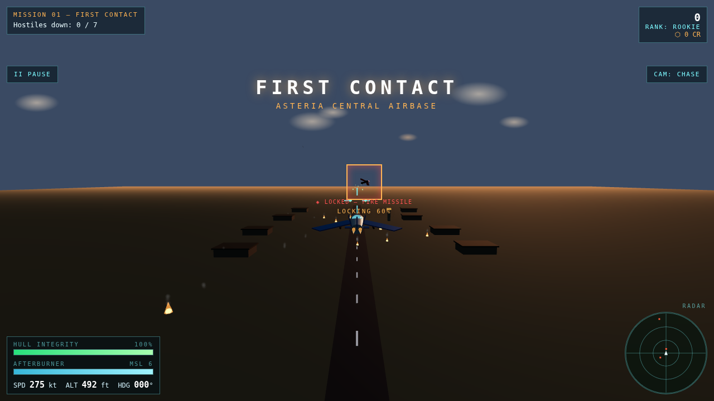

# OPERATION: IRON SKIES

**A 3D fighter jet combat game in a single HTML file.** Three.js (CDN) + Web Audio API.
Zero external 3D models, zero audio files — every jet, city, ship and sound is generated in code.

> November 2032. The Varkovia Federation has invaded. You are **PHANTOM**, elite pilot of
> **Squadron 07**, defending the Republic of Asteria's skies.
> *As long as pilots are willing to fly, Asteria is not defeated yet.*

## ▶ Play it

**GitHub Pages:** enable Pages on this repo (Settings → Pages → branch `main`, folder `/`) and open the published URL — or simply download `index.html` and open it in any modern browser.
An internet connection is needed once, to load Three.js from the CDN. Everything else is in the file.

🎬 Gameplay video: [`shots/gameplay.mp4`](shots/gameplay.mp4)

## Lobby — Hangar

After the opening narration you land in the **Squadron 07 hangar lobby**: your pilot card
(callsign, reputation rank, score, credits, kills), **aircraft selection**, the mission board
(missions unlock as you clear them, cleared ones can be replayed), and the armory/workshop
where credits buy upgrades. Pick a mission → briefing → launch. Debrief returns you to the lobby.

**Progress is saved automatically** in your browser (localStorage): rank, credits, upgrades,
unlocked missions, chosen aircraft and your best Endless wave survive a page refresh.
A two-click Reset Progress button in the lobby wipes it.

### Aircraft

| Jet | Character | Trade-off |
|---|---|---|
| **F/A-07 PHANTOM** | Balanced interceptor | Even speed, hull and firepower |
| **XF-09 VIPER** | Fast strike | +28% speed, stronger guns, fragile hull (×0.72) |
| **A-12 JUGGERNAUT** | Heavy gunship | Hull ×1.65 and hardest hits, −16% speed |

### Free modes

- **FREE FLIGHT** — no hostiles; explore the coast, end the sortie any time with `M` or the ✕ END button
- **ENDLESS** — wave defense over the airbase: waves grow, every cleared wave restocks +2 missiles and repairs hull; your best wave is recorded

### Buildings & world dressing

Beyond the campaign set-pieces, the theatres are populated with procedural window-lit
buildings (with collision): the airbase HQ/barracks and depot blocks, a riverside village
and farmstead in the valley, a supply outpost in the frozen north, and a full port town
with a lighthouse on the Asteria coast in the Black Sea mission.

## Campaign — 6 missions

| # | Mission | Objective |
|---|---------|-----------|
| 01 | **First Contact** | Emergency takeoff over Asteria's burning airbase at dawn; splash the first fighter wave |
| 02 | **Broken Frontier** | Low flight over valleys and rivers; protect the allied ground convoy |
| 03 | **Frozen Horizon** | Night stealth over snowy peaks, searchlights and snowfall; destroy 4 radar bases |
| 04 | **Burning City** | Dogfight between blackout skyscrapers; defend the capital |
| 05 | **Black Sea Offensive** | Animated ocean, naval battle; sink 3 enemy destroyers |
| 06 | **Iron Skies** | Storm showdown vs the elite ace squadron and the SKYHAMMER aerial command cruiser |

## Features

- Procedural 3D jets: PHANTOM stealth fighter (silver-blue delta wing, dynamic afterburner flames) vs Varkovia forward-swept interceptors
- Plasma autocannon tracers, lock-on homing missiles with smoke trails, particle explosions, camera shake, boost FOV kick + wingtip contrails
- Chase camera **and** cockpit POV with working pitch ladder, crosshair, radar minimap, SPD/ALT/HDG gauges
- Fully procedural audio: cannon & explosion synth (Web Audio), dual-layer engine (idle/run equal-power crossfade by speed), wind, lock-on beeps, sirens & radio ambience
- Progression between missions: upgrade **Weapons**, **Engine Speed**, **Armor/Shields**, and call in an **AI Wingman**; pilot reputation ranks from Rookie to Phantom Legend

## Controls

| Action | PC | Mobile |
|---|---|---|
| Pitch / Bank | W/S, A/D or Arrow keys | Virtual joystick |
| Fire cannon | `SPACE` | Auto-fire (targets ahead) |
| Missile (after lock-on) | `F` | MISSILE button |
| Barrel roll (dodges fire) | `Q` / `E` | ROLL button |
| Afterburner | `SHIFT` | BOOST button |
| Camera chase/cockpit | `C` | CAM button |
| End sortie (free modes) | `M` | ✕ END button |
| Pause | `P` | II button |

## Tech notes

- Single file (~93 KB), ES modules + import map pinning `three@0.160.0`
- Pooled particle systems (sparks + smoke), instanced trees/buildings, shared geometries — built to hold 60 FPS on mobile GPUs
- Lock-on: hold a target near the crosshair ≈0.8 s until the reticle turns red, then fire

## License

MIT
